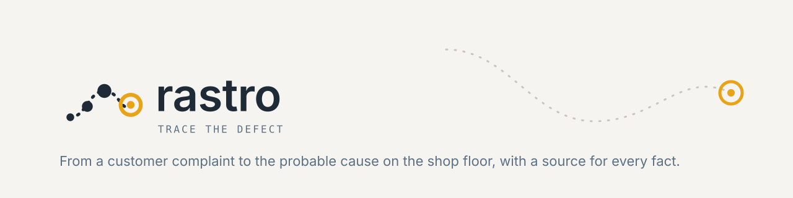
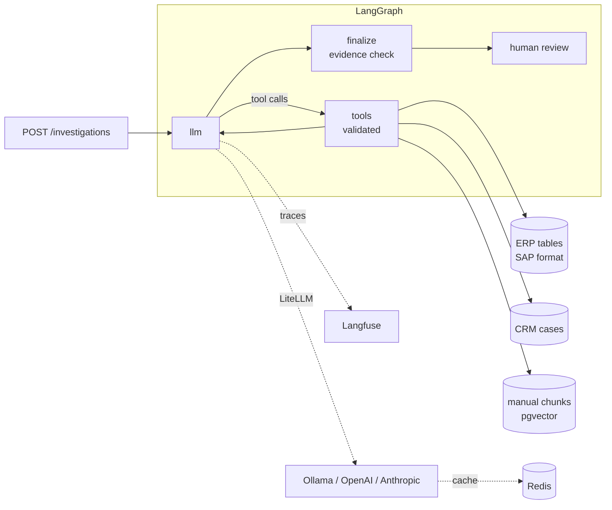

<p align="center">
  <picture>
    <source media="(prefers-color-scheme: dark)" srcset="assets/identity/svg/rastro-banner-dark.svg">
    <source media="(prefers-color-scheme: light)" srcset="assets/identity/svg/rastro-banner-light.svg">
    
  </picture>
</p>

<p align="center">
  An AI agent that follows a customer complaint through CRM and ERP records<br>
  to the machine that made the batch, and hands a sourced report to a quality engineer.
</p>

<p align="center">
  <a href="https://github.com/Oseiasdfarias/rastro-agent/actions/workflows/ci.yml"></a>
  
  
  
  <a href="LICENSE"></a>
</p>

<p align="center">
  <a href="docs/architecture.md">Architecture</a> ·
  <a href="docs/synthetic-data.md">Synthetic data</a> ·
  <a href="docs/evaluation.md">Evaluation</a> ·
  <a href="assets/identity/README.md">Brand</a>
</p>

<p align="center">
  <a href="#english">English</a> · <a href="#português">Português</a>
</p>

---

## English

### The demo moment

```
CRM complaint, delivery number missing
  → agent finds the customer's deliveries of that material in the last 90 days
  → batch origin: production order, work center, press
  → maintenance notes on that press around the production date
  → report: verdict · equipment · failure mode · cited record ids → waiting for human review
```

### The problem

When a customer complains about a batch, a quality engineer rebuilds the trail by hand: CRM
case → delivery → batch → production order → machine → what maintenance wrote that week.
The data is in different systems and the maintenance notes are free text written in a hurry.
It is slow, and it is the kind of reading an LLM does well, as long as every claim can be
checked.

### What it does

- **Tools, not free search.** The model can only call six typed tools (case, delivery, find
  deliveries, batch origin, equipment history, manual search). Arguments are validated before
  anything runs; errors go back to the model as messages.
- **Guards around the model.** Step limit, repeated-call detection, provider fallback, and a
  recovery for small models that write the tool call as text.
- **Every fact has a source.** The final report cites record ids (`QMEL:…`, `AUFK:…`,
  `LIPS:…`). Ids that do not exist, or that no tool returned, are removed and the confidence
  drops. A cause without a maintenance record (QMEL/AUFK) becomes `insufficient_data`;
  manual chunks are context, not evidence.
- **A human decides.** The run pauses for review (approve, reject, edit) and resumes from a
  Postgres checkpoint.
- **Measured against a simpler option.** A fixed pipeline makes the same lookups in a fixed
  order and calls the LLM once. Both are scored on 40 cases with a known answer.

### Architecture



All code is in `src/`, in layers: `domain` (no dependencies) → `application` (ports, fixed
pipeline, evidence check) → `adapters` (Postgres, pgvector, LiteLLM). Swapping the synthetic
ERP for a real one is a new class in `adapters/erp/`. Details in
[docs/architecture.md](docs/architecture.md).

### Results

40 cases with a known answer (30 planted failures, 10 complaints with no factory cause),
`gemini/gemini-3.1-flash-lite`, same tools and same report prompt for both strategies.

| | Fixed pipeline | Agent |
|---|---|---|
| Right verdict | **39 / 40** (97.5%) | 33 / 40 (82.5%) |
| Right equipment (30 failures) | 29 / 30 | 28 / 30 |
| Right failure mode (30 failures) | 29 / 30 | 27 / 30 |
| Noise cases answered "no factory cause" | 10 / 10 | 10 / 10 |
| Tokens per case | 2.1 k | 12.7 k |
| Seconds per case | 1.8 | 7.2 |

**The simpler design won.** This trail always has the same shape (case → delivery → batch →
machine → maintenance), so a fixed sequence of lookups plus one LLM call is more accurate,
6× cheaper and 4× faster than letting the model choose the steps.

Where the agent lost: in 5 of its 7 wrong verdicts it named the right machine and failure mode
but cited no record in the final report (re-runs of those five cases show an empty evidence
list), so the evidence check refused the cause and returned `insufficient_data`. The guard did its job; a cause without a source never reaches the
engineer. An agent earns its cost when the path is not known in advance (several data
sources, follow-up questions), which this dataset does not test.

Full table and per-case results: [results/](results/) · method: [docs/evaluation.md](docs/evaluation.md).
`qwen2.5:3b` on CPU took over 5 minutes per call on long prompts, so the published run uses a
small cloud model; the local model stays the default for `make investigate`.

### Run it

Only Docker is needed on the host. The default model is `qwen2.5:3b` on a local
[Ollama](https://ollama.com); any LiteLLM model works through `LLM_MODELS`.

```bash
cp .env.example .env
make build && make up        # Postgres + pgvector, Redis, API on :8000
make seed                    # synthetic SAP/CRM data + manual index
make investigate CASE=CS-00002
make eval ARGS="--strategy agent --limit 10"
make observability           # optional: Langfuse on :3000
make test                    # unit tests in the container
```

Review through the API:

```bash
curl -s -X POST localhost:8000/investigations -H 'content-type: application/json' \
     -d '{"case_id": "CS-00002"}'
# {"thread_id": "…", "status": "pending_review", "report": {…}}
curl -s -X POST localhost:8000/investigations/<thread_id>/review \
     -H 'content-type: application/json' -d '{"decision": "approve"}'
```

### Repository layout

```
src/rastro/       the application: domain, application, agent, tools, adapters, api
src/synthdata/    synthetic SAP/CRM generator with planted failures and ground truth
src/evals/        scoring and evaluation runner
src/deploy/       Dockerfile and the Langfuse compose file
tests/            unit tests (fakes, no network) and integration tests (Postgres)
docs/             architecture, synthetic data, evaluation, ADRs
results/          evaluation outputs
assets/identity/  logo, favicon, banners, brand guide
```

### Decisions

| Decision | Why |
|---|---|
| LangGraph with our own nodes, LiteLLM called directly | interrupt + checkpoints for review; same gateway for agent and baseline ([ADR 0001](docs/adr/0001-langgraph-with-own-nodes.md)) |
| pgvector, not a separate vector store | one Postgres for ERP, vectors and checkpoints ([ADR 0002](docs/adr/0002-pgvector-instead-of-chroma.md)) |
| Ground truth from the generator | the generator plants the failures, so nobody writes the answer key by hand |
| Ollama context fixed at 16k tokens | its default window silently cuts long prompts |
| No cloud deploy | the image runs anywhere Docker runs; deploying was out of scope |

### Limitations

- **Synthetic data.** One fictional plant, 6 machines, 26 weeks, 5 failure modes. Real
  maintenance text is messier and real complaints are more ambiguous.
- **Small local model.** Results with `qwen2.5:3b` on CPU say as much about the model as about
  the design. Re-run `make eval` with a larger model to compare.
- **40 cases.** Differences of one or two cases are noise.
- **The manual search is weak.** The indexed manual is for electric motors. On the 20 symptom
  notes, 55 of 60 returned chunks were unrelated, and similarity scores do not separate good
  from bad, so no threshold is applied ([details](docs/evaluation.md#manual-retrieval-2026-11-16)).
  Manual chunks are context only; a cause needs a maintenance record.
- **No real SAP connection.** Table and field names follow SAP; no RFC/OData client exists.
- The `cli` service uses host networking to reach a host Ollama, which is Linux only
  ([ADR 0003](docs/adr/0003-cli-on-host-network.md)).

### License

MIT. The WEG motor manual is downloaded from the manufacturer at seed time and is not
redistributed here.

---

## Português

Um agente de IA que segue a reclamação de um cliente pelos registros do CRM e do ERP até a máquina que fez o lote, e entrega um relatório com fontes para o engenheiro da qualidade.

### O problema

Quando um cliente reclama de um lote, o engenheiro da qualidade monta o rastro à mão: caso no
CRM → entrega → lote → ordem de produção → máquina → o que a manutenção escreveu naquela
semana. Os dados estão em sistemas diferentes e as notas de manutenção são texto livre escrito
às pressas. É uma leitura que um LLM faz bem, desde que cada afirmação possa ser conferida.

### O que o projeto faz

- **Ferramentas, não busca livre.** O modelo só chama seis ferramentas com argumentos
  validados antes de rodar. Erro volta para o modelo como mensagem.
- **Proteções em volta do modelo.** Limite de passos, chamada repetida bloqueada, troca de
  provedor quando um cai, e recuperação de chamada de ferramenta escrita como texto.
- **Todo fato tem fonte.** O relatório cita ids de registro (`QMEL:…`, `AUFK:…`, `LIPS:…`). Id
  que não existe ou que nenhuma ferramenta devolveu é removido. Causa sem registro de manutenção (QMEL/AUFK) vira
  `insufficient_data`.
- **Uma pessoa decide.** A execução pausa para revisão (aprovar, recusar, editar) e retoma de
  um checkpoint no Postgres.
- **Medido contra uma opção mais simples.** Um pipeline fixo faz as mesmas consultas em ordem
  fixa e chama o LLM uma vez. Os dois são avaliados em 40 casos com resposta conhecida.

### Resultados

40 casos (30 falhas plantadas, 10 reclamações sem causa de fábrica),
`gemini/gemini-3.1-flash-lite`, mesmas ferramentas e mesmo prompt de relatório.

| | Pipeline fixo | Agente |
|---|---|---|
| Veredito certo | **39 / 40** | 33 / 40 |
| Equipamento certo (30 falhas) | 29 / 30 | 28 / 30 |
| Modo de falha certo (30 falhas) | 29 / 30 | 27 / 30 |
| Ruído respondido como "sem causa de fábrica" | 10 / 10 | 10 / 10 |
| Tokens por caso | 2,1 mil | 12,7 mil |
| Segundos por caso | 1,8 | 7,2 |

**O desenho mais simples ganhou.** Este rastro tem sempre o mesmo formato, então uma sequência
fixa de consultas mais uma chamada ao LLM acerta mais, custa 6 vezes menos e é 4 vezes mais
rápida do que deixar o modelo escolher os passos. Em 5 dos 7 vereditos errados, o agente
apontou a máquina e o modo de falha certos, mas não citou nenhum registro; a checagem de
evidência recusou a causa. Agente vale o custo quando o caminho não é conhecido de antemão, o
que este conjunto de dados não testa.

### Como rodar

Só precisa de Docker. O modelo padrão é `qwen2.5:3b` num Ollama local; qualquer modelo do
LiteLLM funciona por `LLM_MODELS`.

```bash
cp .env.example .env
make build && make up        # Postgres + pgvector, Redis, API na porta 8000
make seed                    # dados sintéticos SAP/CRM + índice do manual
make investigate CASE=CS-00002
make eval ARGS="--strategy agent --limit 10"
make observability           # opcional: Langfuse na porta 3000
make test
```

### Limitações

- **Dados sintéticos.** Uma fábrica fictícia, 6 máquinas, 26 semanas, 5 modos de falha. Nomes
  de tabela e campo seguem o SAP; não há conexão com SAP real.
- **40 casos.** Diferença de um ou dois casos é ruído.
- **A busca no manual é fraca.** O manual indexado é de motores elétricos. Nas 20 notas de
  sintoma, 55 dos 60 trechos devolvidos não tinham relação, e a nota de semelhança não separa o
  bom do ruim; por isso não há limite. Trecho de manual é só contexto; causa precisa de registro
  de manutenção.
- **Um modelo pequeno na nuvem.** O `qwen2.5:3b` em CPU passou de 5 minutos por chamada nos
  prompts longos.

### Licença

MIT. O manual de motores da WEG é baixado do fabricante no seed e não é redistribuído aqui.
