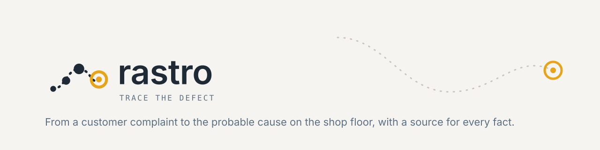

<p align="center">
  <picture>
    <source media="(prefers-color-scheme: dark)" srcset="assets/identity/svg/rastro-banner-dark.svg">
    <source media="(prefers-color-scheme: light)" srcset="assets/identity/svg/rastro-banner-light.svg">
    
  </picture>
</p>

<p align="center">
  Um agente de IA que segue a reclamação de um cliente pelos registros do CRM e do ERP<br>
  até a máquina que fez o lote, e entrega um relatório com fontes para o engenheiro da qualidade.
</p>

<p align="center">
  <a href="README.md">English</a> ·
  <a href="docs/architecture.md">Arquitetura</a> ·
  <a href="docs/synthetic-data.md">Dados sintéticos</a> ·
  <a href="docs/evaluation.md">Avaliação</a>
</p>

---

## O problema

Quando um cliente reclama de um lote, o engenheiro da qualidade monta o rastro à mão: caso no
CRM → entrega → lote → ordem de produção → máquina → o que a manutenção escreveu naquela
semana. Os dados estão em sistemas diferentes e as notas de manutenção são texto livre escrito
às pressas. É uma leitura que um LLM faz bem, desde que cada afirmação possa ser conferida.

## O que o projeto faz

- **Ferramentas, não busca livre.** O modelo só chama seis ferramentas com argumentos
  validados antes de rodar. Erro volta para o modelo como mensagem.
- **Proteções em volta do modelo.** Limite de passos, chamada repetida bloqueada, troca de
  provedor quando um cai, e recuperação de chamada de ferramenta escrita como texto.
- **Todo fato tem fonte.** O relatório cita ids de registro (`QMEL:…`, `AUFK:…`, `LIPS:…`). Id
  que não existe ou que nenhuma ferramenta devolveu é removido. Causa sem evidência vira
  `insufficient_data`.
- **Uma pessoa decide.** A execução pausa para revisão (aprovar, recusar, editar) e retoma de
  um checkpoint no Postgres.
- **Medido contra uma opção mais simples.** Um pipeline fixo faz as mesmas consultas em ordem
  fixa e chama o LLM uma vez. Os dois são avaliados em 40 casos com resposta conhecida.

## Resultados

40 casos (30 falhas plantadas, 10 reclamações sem causa de fábrica),
`gemini/gemini-3.1-flash-lite`, mesmas ferramentas e mesmo prompt de relatório.

| | Pipeline fixo | Agente |
|---|---|---|
| Veredito certo | **39 / 40** | 33 / 40 |
| Equipamento certo (30 falhas) | 29 / 30 | 28 / 30 |
| Modo de falha certo (30 falhas) | 29 / 30 | 27 / 30 |
| Ruído respondido como "sem causa de fábrica" | 10 / 10 | 10 / 10 |
| Tokens por caso | 2,1 mil | 12,7 mil |
| Segundos por caso | 1,8 | 7,2 |

**O desenho mais simples ganhou.** Este rastro tem sempre o mesmo formato, então uma sequência
fixa de consultas mais uma chamada ao LLM acerta mais, custa 6 vezes menos e é 4 vezes mais
rápida do que deixar o modelo escolher os passos. Em 5 dos 7 vereditos errados, o agente
apontou a máquina e o modo de falha certos, mas não citou nenhum registro; a checagem de
evidência recusou a causa. Agente vale o custo quando o caminho não é conhecido de antemão, o
que este conjunto de dados não testa.

## Como rodar

Só precisa de Docker. O modelo padrão é `qwen2.5:3b` num Ollama local; qualquer modelo do
LiteLLM funciona por `LLM_MODELS`.

```bash
cp .env.example .env
make build && make up        # Postgres + pgvector, Redis, API na porta 8000
make seed                    # dados sintéticos SAP/CRM + índice do manual
make investigate CASE=CS-00002
make eval ARGS="--strategy agent --limit 10"
make observability           # opcional: Langfuse na porta 3000
make test
```

## Limitações

- **Dados sintéticos.** Uma fábrica fictícia, 6 máquinas, 26 semanas, 5 modos de falha. Nomes
  de tabela e campo seguem o SAP; não há conexão com SAP real.
- **40 casos.** Diferença de um ou dois casos é ruído.
- **Um modelo pequeno na nuvem.** O `qwen2.5:3b` em CPU passou de 5 minutos por chamada nos
  prompts longos.

## Licença

MIT. O manual de motores da WEG é baixado do fabricante no seed e não é redistribuído aqui.
