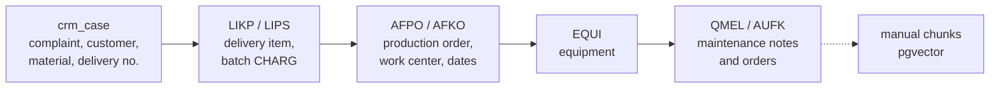
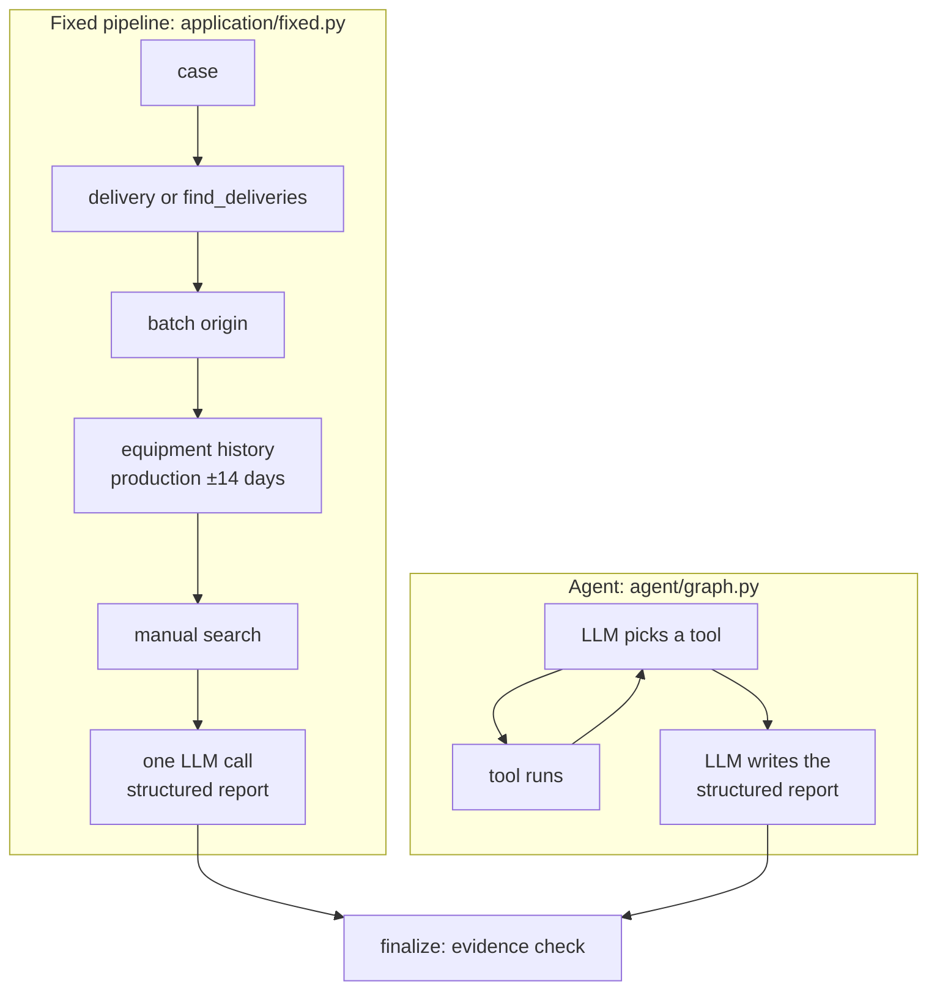
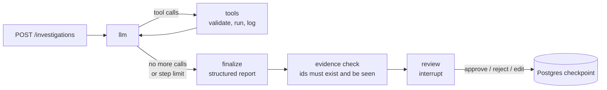
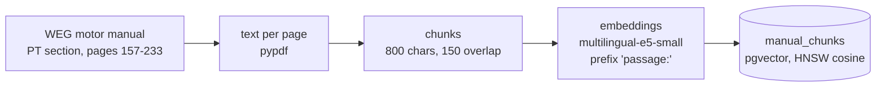
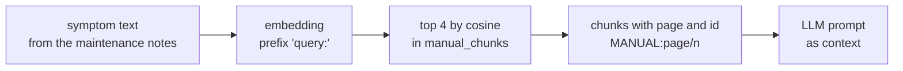

# Architecture

## Layers

```
src/rastro/
  domain/        Case, Delivery, BatchOrigin, MaintenanceEvent, RootCauseReport, record ids
  application/   ports (interfaces), fixed pipeline, finalize (evidence check)
  agent/         LangGraph graph: llm -> tools -> llm ... -> finalize -> review
  tools/         argument models + registry the LLM can call
  adapters/      Postgres ERP/CRM, pgvector manuals, LiteLLM gateway, step log
  api/           FastAPI
  composition.py wires adapters into ports
```

`domain` imports nothing from the project. `application` only knows the ports. Replacing the
synthetic ERP by a real one means writing a new class under `adapters/erp/` that implements
`ErpPort` (for SAP, typically OData services); nothing else changes.

## Ports

| Port | Methods | Implementation |
|---|---|---|
| `CrmPort` | `get_case`, `list_case_ids` | `adapters/crm/postgres.py` |
| `ErpPort` | `get_delivery`, `find_deliveries`, `get_batch_origin`, `get_equipment_history`, `record_exists` | `adapters/erp/postgres.py` |
| `ManualsPort` | `search(query, k)` | `adapters/manuals/pgvector.py` |
| `LlmPort` | `chat(messages, tools, response_format)` | `adapters/llm/gateway.py` (LiteLLM) |

`tests/fakes.py` has in-memory versions of the first three and a scripted LLM, so unit tests
need no database, network or model.

## The trail through the data



Every record has an id like `LIPS:80001251/000010` or `QMEL:300000158`
(`domain/records.py`); the report cites these ids and `finalize` checks them. When the
delivery number is missing or wrong, `find_deliveries` searches the customer's deliveries of
that material in the 90 days before the complaint.

## Two strategies, same tools



Both read the same ports (the agent through `tools/registry.py`), use the same report prompt
(`agent/prompts/report.md`) and the same `finalize`. The API runs the agent with human review;
the fixed pipeline is the baseline in the evaluation.

## One investigation



Guards in the loop:

| Guard | Where | What happens |
|---|---|---|
| Step limit (`MAX_STEPS`, 8) | `agent/graph.py` | goes to finalize with what it has |
| Same call twice | `agent/graph.py` | not executed; the model gets an error message |
| Unknown tool, bad JSON, wrong type, window > 60 days | `tools/registry.py` | error returned as a tool message |
| Tool call written as text by a small model | `adapters/llm/gateway.py` | recovered as a real call |
| Record id that does not exist or was never returned by a tool | `application/finalize.py` | removed, confidence halved, noted in `open_questions` |
| `factory_cause` with no maintenance record (QMEL/AUFK) left | `application/finalize.py` | becomes `insufficient_data` |
| Provider down | `adapters/llm/gateway.py` | next model in `LLM_MODELS`; if none, API answers 503 |

## RAG over the maintenance manual

The agent combines two kinds of retrieval: exact SQL lookups for the trail (case, delivery,
batch, machine, maintenance) and RAG over the equipment manual for background on the symptom.

**Indexing** (once, in `make seed`, `adapters/manuals/ingest.py`):



**Query** (every time `search_manuals` runs, `adapters/manuals/pgvector.py`):



Where it is used:

| Strategy | How the manual is searched |
|---|---|
| Fixed pipeline | always once, with the text of the last maintenance notes (or the complaint if there are none) |
| Agent | `search_manuals` is one of the six tools; the model decides when and with which words |

Rules:
- Chunk ids (`MANUAL:216/0`) can be cited in the report, but a manual chunk is never evidence
  for a cause. `finalize` accepts `factory_cause` only with a QMEL or AUFK record.
- The settings (model, chunk size, overlap, Portuguese section) come from the measurements in
  rag-manual-poc ([ADR 0002](adr/0002-pgvector-instead-of-chroma.md)).

Measured here (`rastro eval-manuals`, 20 symptom notes × top 3): bearing questions find a
relevant chunk 4 of 4 times; misalignment 0 of 4; for heater, mold and pressure-sensor faults
the manual has nothing relevant but the search still returns 3 chunks every time. 55 of 60
returned chunks are unrelated, and similarity scores (0.83 to 0.88) do not separate relevant
from unrelated, so no threshold is used. The fix is one manual per equipment with the search
filtered by the machine that made the batch. Details in
[evaluation.md](evaluation.md#manual-retrieval-2026-11-16).

## Services

| Service | Image | Role |
|---|---|---|
| `db` | pgvector/pgvector:pg16 | SAP/CRM tables, manual vectors, LangGraph checkpoints |
| `redis` | redis:7-alpine | LiteLLM response cache |
| `api` | built from `src/deploy/Dockerfile` | FastAPI on :8000 |
| `seed`, `cli` | same image | data load; eval and investigate (host network, to reach a host Ollama) |
| `langfuse-web`, `langfuse-worker`, `langfuse-db`, `clickhouse`, `minio` | langfuse/langfuse:3, clickhouse 24.8, postgres 16, cgr.dev/chainguard/minio | tracing UI on :3000, profile `observability` |
| `ollama` | ollama/ollama | optional, profile `local-llm` |
