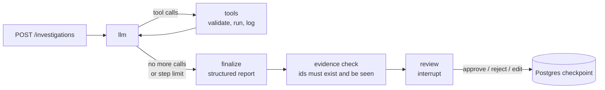

# Architecture

## Layers

```
src/rastro/
  domain/        Case, Delivery, BatchOrigin, MaintenanceEvent, RootCauseReport, record ids
  application/   ports (interfaces), fixed pipeline, finalize (evidence check)
  agent/         LangGraph graph: llm -> tools -> llm ... -> finalize -> review
  tools/         argument models + registry the LLM can call
  adapters/      Postgres ERP/CRM, pgvector manuals, LiteLLM gateway, step log
  api/           FastAPI
  composition.py wires adapters into ports
```

`domain` imports nothing from the project. `application` only knows the ports. Replacing the
synthetic ERP by a real one means writing a new class under `adapters/erp/` that implements
`ErpPort` (for SAP, typically OData services); nothing else changes.

## One investigation



Guards in the loop:

| Guard | Where | What happens |
|---|---|---|
| Step limit (`MAX_STEPS`, 8) | `agent/graph.py` | goes to finalize with what it has |
| Same call twice | `agent/graph.py` | not executed; the model gets an error message |
| Unknown tool, bad JSON, wrong type, window > 60 days | `tools/registry.py` | error returned as a tool message |
| Tool call written as text by a small model | `adapters/llm/gateway.py` | recovered as a real call |
| Record id that does not exist or was never returned by a tool | `application/finalize.py` | removed, confidence halved, noted in `open_questions` |
| `factory_cause` with no evidence left | `application/finalize.py` | becomes `insufficient_data` |
| Provider down | `adapters/llm/gateway.py` | next model in `LLM_MODELS`; if none, API answers 503 |

## Services

| Service | Image | Role |
|---|---|---|
| `db` | pgvector/pgvector:pg16 | SAP/CRM tables, manual vectors, LangGraph checkpoints |
| `redis` | redis:7-alpine | LiteLLM response cache |
| `api` | built from `src/deploy/Dockerfile` | FastAPI on :8000 |
| `seed`, `cli` | same image | data load; eval and investigate (host network, to reach a host Ollama) |
| `langfuse-*`, `clickhouse`, `minio` | official images | tracing UI on :3000, profile `observability` |
| `ollama` | ollama/ollama | optional, profile `local-llm` |
